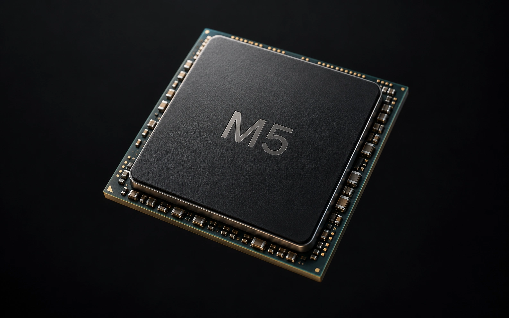

# Inside Silicon — M5 Deep Dive

**Scroll from an Apple M5 chip all the way down to a single silicon atom, in one continuous camera move.**

### [▶ Try it live](https://arunsai63.github.io/m5-deepdive/)



---

## The journey

One scroll takes you through six levels of scale, with no cuts or scene changes.

| | Stop | What you see |
|---|---|---|
| 1 | **A world within** | The M5 package, a whole architecture inside a piece of silicon |
| 2 | **Beneath the surface** | The die, where CPU cores, GPU blocks and memory sit side by side |
| 3 | **Order at every scale** | Inside a core: SRAM arrays next to rows of logic cells |
| 4 | **A different kind of skyline** | Copper wiring layers stacked like a city, joined by vias |
| 5 | **It comes down to a switch** | A single transistor, the tiny gate repeated billions of times |
| 6 | **One atom** | Through an opening in the transistor into the silicon crystal, ending on one atom |

## Highlights

- **Real-time 3D in the browser.** Built with WebGL and Three.js, running smoothly at 60 fps.
- **One unbroken zoom.** The camera stays in a single nested world from millimetres down to atoms.
- **3,415 atoms.** The ending is a real diamond-cubic silicon lattice built to correct proportions.
- **Labels on the geometry.** Annotations stay attached to the parts they describe as you move.
- **Works everywhere.** Responsive on phones, respects reduced-motion settings, and needs no build step.

## Run it locally

```sh
python3 -m http.server 8000
```

Then open http://localhost:8000.

## Inspiration

Inspired by [MKBHD × Epic Spaceman's M5 exploration](https://www.youtube.com/watch?v=Jh9pFp1oM7E).

> This is an artistic, educational visualisation. It isn't Apple's actual chip layout. Colours and shapes are chosen to explain, not to photograph.

---

Made by [arunsai63](https://github.com/arunsai63)
